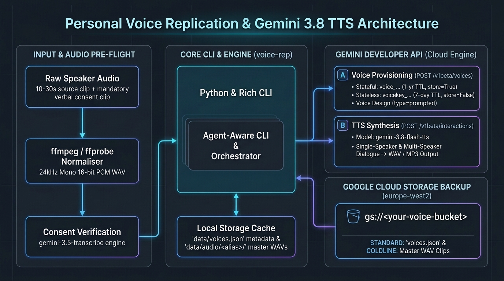

# Personal Voice Replication & Expressive TTS Manager (`voice-replication`)

A Python 3.13 library and dual-mode Rich/Typer CLI (`voice-rep`) for creating, persisting, auditing, and synthesising speech with personal replicated voices and companion Voice Design personas using Google's **Gemini 3.8 Flash TTS** (`gemini-3.8-flash-tts` and `gemini-3.8-flash-lite-tts`) and **Google Cloud Storage** (`<your-project>`).



## Repo Metadata

- **Author**: Darren "Dazbo" Lester (`derailed-dash`)
- **Language & Runtime**: Python 3.13 (`uv`)
- **Target GCP Project**: `<your-project>` (`europe-west2` London)

## Table of Contents

- [Key Project Documentation](#key-project-documentation)
- [Key Links & Official References](#key-links--official-references)
- [Features](#features)
- [Project Structure](#project-structure)
- [Architecture and Tech Stack - at a Glance](#architecture-and-tech-stack---at-a-glance)
- [Quick Start: Working With This Repo](#quick-start-working-with-this-repo)
- [Common Scenarios: CLI (`make`) vs Google AI Studio](#common-scenarios-cli-make-vs-google-ai-studio)
- [Useful Commands](#useful-commands)
- [Verification, Rubrics & Loopy TDD Workflow](#verification-rubrics--loopy-tdd-workflow)
- [Troubleshooting](#troubleshooting)

## Key Project Documentation

| Document | Description |
| :--- | :--- |
| [README.md](README.md) | Developer front door, quick start, CLI vs Google AI Studio scenarios, and command reference |
| [SPEC.md](SPEC.md) | Complete system specification, boundaries, and acceptance criteria |
| [LOOPS.md](LOOPS.md) | Repeatable Loopy + TDD vertical slice loop definition |
| [TODO.md](TODO.md) | Ordered project task list and verification checkpoints |
| [tasks/plan.md](tasks/plan.md) | Technical implementation plan, dependency mapping, and risk register |
| [docs/architecture-and-walkthrough.md](docs/architecture-and-walkthrough.md) | Architectural Decision Records (ADRs), storage class analysis, and data models |
| [docs/testing.md](docs/testing.md) | Two-tier verification strategy, TDD cycle, and test suite guide |
| [deployment/README.md](deployment/README.md) | GCP project setup, API enablement, collaborator sharing, Coldline bucket provisioning, and `git-crypt` |

## Key Links & Official References

### Google AI Studio & Gemini API Documentation

- [Gemini API — Voice Replication Guide](https://aistudio.google.com/docs/voice-replication) — Stateful (`store=True`) vs stateless (`store=False`) voice replication, consent phrases by language, and best practices for 24kHz mono WAV reference audio.
- [Gemini API — Speech Generation (TTS) Guide](https://aistudio.google.com/docs/speech-generation) — Single-speaker and multi-speaker synthesis, turn-level `speech_metadata` styling, inline vocal tags, and Studio voices.
- [Gemini API — Voice Design Guide](https://aistudio.google.com/docs/voice-design) — Creating persistent custom vocal personas (`type="prompted"`) from natural-language descriptions.
- [Gemini API — Audio Transcription (`gemini-3.5-transcribe`)](https://aistudio.google.com/docs/transcribe) — Verbatim and smart speech-to-text recognition across 85+ locales.
- [Gemini API — Interactions API Overview](https://aistudio.google.com/docs/interactions-overview) — Unified `client.interactions.create` surface for text, audio, and multimodal generation.
- [Google AI Studio — Generate Speech Playground](https://aistudio.google.com/generate-speech) — Interactive browser studio for auditioning voices and testing prompts.

### Google Cloud Storage & Security Documentation

- [Google Cloud Storage — Storage Classes](https://docs.cloud.google.com/storage/docs/storage-classes) — At-rest pricing, minimum storage durations (30d Nearline, 90d Coldline, 365d Archive), and millisecond retrieval characteristics.
- [Google Cloud Storage — Pricing](https://cloud.google.com/storage/pricing) — Storage, Class A/B operations, retrieval, and early-deletion fee breakdown.
- [Google Cloud Storage — Autoclass Overview](https://docs.cloud.google.com/storage/docs/autoclass) — Automated object transitions and `128 KiB` minimum object size rules.
- [Google Cloud Storage — Uniform Bucket-Level Access (UBLA)](https://cloud.google.com/storage/docs/uniform-bucket-level-access) — Standardising access control around IAM.
- [Google Cloud Storage — Public Access Prevention](https://cloud.google.com/storage/docs/public-access-prevention) — Enforcing private-only bucket access.
- [Google Cloud Storage — Soft Delete](https://cloud.google.com/storage/docs/soft-delete) — Protecting against accidental object or bucket deletion.
- [Google Cloud Storage — Enforce Encryption Types](https://cloud.google.com/storage/docs/encryption/enforce-encryption-types) — Restricting Customer-Supplied Encryption Keys (CSEK).

## Features

- **Automated Audio Pre-Flight (`prep-audio`)**: Converts any raw recording (`.m4a`, `.mp3`, `.wav`, `.ogg`, stereo, 44.1/48kHz) stored in `data/raw/` into the recommended **24kHz mono 16-bit PCM WAV** format in `data/audio/<alias>/` using `ffmpeg`, validates the mandatory **10.0–30.0 second** reference duration via `ffprobe`, supports start/end trimming (`--trim-start`, `--trim-end`), and verifies that your consent clip recites the mandatory consent statement using `gemini-3.5-transcribe`.
- **Multi-Tier Voice Persistence (`<your-project>`)**:
  - **Gemini API Stateful Storage (`store=True`)**: Stores your verified `voice_...` profile in `<your-project>` (up to 200 custom voices per project, **1-year retention TTL**), making it immediately available in both the CLI and the [Google AI Studio Speech Playground](https://aistudio.google.com/generate-speech).
  - **Stateless Client-Managed Keys (`store=False`)**: Optionally issues encrypted `voicekey_...` tokens (**7-day TTL**) for zero server-side storage.
  - **Cost-Optimised GCS Backup (`europe-west2`)**: Syncs your master 24kHz `.wav` recordings to a private Regional GCS bucket using the **`COLDLINE`** default storage class (\$0.004/GiB/month, millisecond access) while explicitly overriding `voices.json` to **`STANDARD`** storage class so frequent metadata updates never trigger Coldline 90-day early-deletion charges.
- **Voice Design Co-Hosts (`design`)**: Creates persistent synthetic voices (`type="prompted"`) from natural-language descriptions to pair with your replicated voice in dialogues.
- **Single-Speaker & Multi-Speaker TTS (`speak`, `dialogue`)**: Synthesises inline text, Markdown monologues (`.md`/`.txt`), or multi-speaker YAML dialogue scripts (`.yaml`) with turn-level `speech_metadata` style instructions. Outputs default to `.mp3` (`output/speech.mp3`, `output/dialogue.mp3`) and automatically clean up intermediate `.wav` files after MP3 encoding.
- **Agent-Aware Dual-Mode CLI**: Every command supports `--json` for deterministic agent parsing, and every mutating command supports `--dry-run` for safe validation.

## Project Structure

Raw voice recordings belong in `data/raw/` and personal YAML dialogue scripts belong in `data/scripts/` (both git-ignored under `data/` so biometric audio and personal scripts are never committed to Git), while synthesised audio outputs are written to `output/` (defaulting to `.mp3`).

```text
voice-replication/
├── data/                           # Git-ignored local workspace for biometric audio & personal scripts
│   ├── audio/<alias>/              # Normalised 24kHz mono 16-bit PCM WAVs (source.wav, consent.wav)
│   ├── raw/                        # Raw source & consent recordings (.m4a, .mp3, .wav, .ogg)
│   ├── scripts/                    # Personal multi-speaker YAML dialogue scripts
│   └── voices.json                 # Local voice registry (synced to GCS as STANDARD class)
├── deployment/
│   └── README.md                   # GCP project setup, API enablement, collaborator sharing & git-crypt
├── docs/
│   ├── images/
│   │   └── architecture.png        # System architecture diagram
│   ├── architecture-and-walkthrough.md # ADRs, storage class rationale, and component design
│   └── testing.md                  # TDD loop, static gates, and test suite reference
├── examples/
│   ├── dialogue.yaml               # Sample two-speaker podcast dialogue script
│   └── monologue.md                # Sample single-speaker narration script with vocal tags
├── output/                         # Git-ignored synthesised audio outputs (defaults to .mp3)
├── src/
│   └── voice_replication/
│       ├── __init__.py             # Public library exports
│       ├── audio.py                # ffmpeg/ffprobe 24kHz mono WAV normalisation & MP3 export
│       ├── cli.py                  # Typer + Rich agent-aware CLI (voice-rep)
│       ├── client.py               # Gemini Voices & Interactions API wrapper
│       ├── config.py               # Pydantic Settings (.env / environment configuration)
│       ├── consent.py              # Consent phrase registry & gemini-3.5-transcribe verifier
│       ├── models.py               # Pydantic schemas (VoiceRecord, VoiceCatalogue, DialogueScript)
│       └── storage.py              # Local voices.json registry & GCS Coldline/Standard sync
├── tasks/
│   └── plan.md                     # Implementation plan and dependency breakdown
├── tests/                          # Offline pytest unit & integration suite
├── .env.template                   # Committed environment variable template
├── .gitattributes                  # git-crypt encryption rules for .env.enc
├── .gitignore                      # Excludes .env, data/, output/, and raw audio files
├── LOOPS.md                        # Saved Loopy TDD vertical slice loop
├── Makefile                        # Self-documenting automation (.DEFAULT_GOAL := help)
├── pyproject.toml                  # Python 3.13 + uv package and tool configuration
├── README.md                       # This file
├── SPEC.md                         # Project specification
└── TODO.md                         # Project task checklist
```

## Architecture and Tech Stack - at a Glance

| Layer | Technology | Role |
| :--- | :--- | :--- |
| **Runtime & Packaging** | Python `>=3.13`, `uv`, `hatchling` | Fast, reproducible virtual environment and CLI entrypoint (`voice-rep`) |
| **Speech & Voice API** | `google-genai >= 2.30.1` | `client.voices` (`POST /v1beta/voices`) & `client.interactions.create` (`gemini-3.8-flash-tts`, `gemini-3.8-flash-lite-tts`, `gemini-3.5-transcribe`) |
| **Cloud Backup** | `google-cloud-storage >= 3.0.0` | Regional (`europe-west2`) bucket sync (`COLDLINE` default for `.wav` + `STANDARD` override for `voices.json`) |
| **Audio Engine** | `ffmpeg` & `ffprobe` | Resampling to 24kHz mono 16-bit PCM WAV (`pcm_s16le`), duration checks, trimming, and `libmp3lame` MP3 encoding |
| **CLI & Validation** | `typer`, `rich`, `pydantic`, `pydantic-settings`, `pyyaml` | Dual-mode human TUI tables and agent-friendly `--json` / `--dry-run` commands |

See [docs/architecture-and-walkthrough.md](docs/architecture-and-walkthrough.md) for full Architectural Decision Records (ADRs) and data flow details.

## Quick Start: Working With This Repo

### Prerequisites

1. **Python 3.13 & `uv`**: Installed at `/usr/local/bin/uv` or `~/.local/bin/uv`.
2. **`ffmpeg` & `ffprobe`**: Installed via system package manager (`sudo apt install ffmpeg`).
3. **Google Cloud SDK (`gcloud`)**: Authenticated with Application Default Credentials (`gcloud auth application-default login`) for project `<your-project>`.
4. **Required GCP APIs Enabled**: `generativelanguage.googleapis.com`, `storage.googleapis.com`, and `apikeys.googleapis.com` enabled on `<your-project>` (see [deployment/README.md](deployment/README.md) for full setup commands).
5. **Gemini API Key**: Created in [Google AI Studio](https://aistudio.google.com/apikey) and linked to the **`<your-project>`** GCP project.

### One-Time Setup

```bash
# 1. Install Python dependencies and dev tooling into .venv
make install

# 2. Create your local .env from the template and populate GEMINI_API_KEY
cp .env.template .env

# 3. Inspect and run the GCS Bucket Architect pre-flight & bucket creation in <your-project>
make gcs-preflight
make gcs-init FLAGS="--dry-run"
# When ready to provision gs://<voice-name>-voice-replication in europe-west2:
make gcs-init
```

### Per Dev Session

```bash
# View all self-documenting make targets and active .env configuration
make

# Verify the full static + unit test gate (codespell, ruff, pyright, pytest)
make check
```

## Common Scenarios: CLI (`make`) vs Google AI Studio

Because stateful replicated voices (`store=True`) are stored inside your Google Cloud project (`<your-project>`), voices created via the `make` CLI are immediately available in the [Google AI Studio Speech Playground](https://aistudio.google.com/generate-speech) — and vice versa.

### Scenario 1: Replicating a Voice (Single Speaker & Multiple Speakers)

For each speaker you want to replicate (for example, `dazbo` and `kate`), record two audio clips on the **same microphone in the same quiet room** and place them in `data/raw/`:

1. **Sample / Reference clip (`10.0–30.0s`)**: Natural, expressive speech matching the tone you want to synthesise.
2. **Consent clip**: Clearly recite the mandatory English consent statement:
   > *"I am the owner of this voice and I consent to Google using this voice to create a synthetic voice model."*

#### Via the CLI (`make`)

```bash
# 1. Speaker 1 (dazbo): Normalise raw audio to 24kHz mono WAV & verify consent via gemini-3.5-transcribe
make prep-audio \
  SOURCE=data/raw/dazbo_sample.m4a \
  CONSENT=data/raw/dazbo_consent.m4a \
  ALIAS=dazbo

# Register 'dazbo' in Gemini API (store=True, 1-year TTL)
make create \
  ALIAS=dazbo \
  DISPLAY_NAME="Dazbo Primary" \
  STYLE="warm, articulate British technical presenter"

# 2. Speaker 2 (kate): Normalise raw audio & verify consent (trimming if >30s)
make prep-audio \
  SOURCE=data/raw/kate_sample.m4a \
  CONSENT=data/raw/kate_consent.m4a \
  ALIAS=kate \
  TRIM_END=28

# Register 'kate' in Gemini API (store=True, 1-year TTL)
make create \
  ALIAS=kate \
  DISPLAY_NAME="Kate Primary" \
  STYLE="warm, expressive British storyteller"

# 3. Back up voices.json (STANDARD) and master 24kHz WAVs (COLDLINE) to GCS
make sync-push
```

#### Via Google AI Studio Browser UI

1. Open [https://aistudio.google.com/generate-speech](https://aistudio.google.com/generate-speech) and ensure **`<your-project>`** is selected.
2. In the left sidebar under **Creation tools**, click **`+ Create new voice`**.
3. Upload or record your **Reference audio** (`10–30s`) and **Consent audio** (reciting the exact consent phrase), enter a display name (e.g. `Dazbo Primary`), and save.
4. To pull voices created in the browser UI into your local CLI catalogue, run `make list-remote`.

### Scenario 2: Single-Speaker TTS Synthesis

#### Via the CLI (`make`)

`make speak` defaults to writing `output/speech.mp3` (automatically encoding via `ffmpeg` and cleaning up the temporary `.wav` file):

```bash
# Synthesise inline text using your default voice alias (defaults to output/speech.mp3)
make speak TEXT="Hello! This is a quick single-speaker synthesis test."

# Synthesise inline text with a specific voice alias, style, and output path
make speak \
  ALIAS=kate \
  STYLE="cheerful and welcoming" \
  TEXT="Welcome back to the show!" \
  OUT=output/kate_welcome.mp3

# Synthesise a Markdown or text monologue script (supports inline vocal tags like [sigh], [laugh])
make speak \
  ALIAS=dazbo \
  FILE=examples/monologue.md \
  OUT=output/monologue.mp3
```

#### Via Google AI Studio Browser UI

1. Open [https://aistudio.google.com/generate-speech](https://aistudio.google.com/generate-speech) and click **`+ Create new dialog`**.
2. Click the **`Speaker 1`** voice pill on the speech block (or click **`Open voice settings`** in the right-hand **Run settings** pane).
3. Select your replicated voice (**`Dazbo Primary`** or **`Kate Primary`**) at the very top of the **Available voices** list.
4. Optionally add delivery instructions in the **`Style instructions`** field, type your script (including inline tags such as `[sigh]`, `[laugh]`, `[whispering]`), and click **`Run`** (`Ctrl+Enter`).

### Scenario 3: Multi-Speaker Two-Host Dialogue (e.g. `dazbo` + `kate`)

#### Via the CLI (`make`)

Store personal multi-speaker dialogue scripts in `data/scripts/` (git-ignored) using the schema shown in [examples/dialogue.yaml](examples/dialogue.yaml). Each turn references a local voice alias (`dazbo`, `kate`), a `voice_...` ID, or a prebuilt Studio voice name (`Kore`, `Puck`), along with optional per-turn `style` directions and inline vocal tags:

```yaml
model: gemini-3.8-flash-tts
speakers:
  Dazbo: dazbo
  Kate: kate
turns:
  - speaker: Dazbo
    style: "warm, playful British storyteller"
    text: "Hello there! [chuckle] Ready to test our two replicated voices together?"
  - speaker: Kate
    style: "warm, expressive and amused British co-host"
    text: "Absolutely! [laugh] It is slightly surreal hearing both of us generated from a YAML file."
```

Run `make dialogue` to synthesise the multi-speaker conversation to `.mp3`:

```bash
# Synthesise the sample dialogue (outputs to output/speech.mp3 or output/dialogue.mp3)
make dialogue SCRIPT=examples/dialogue.yaml OUT=output/podcast_intro.mp3

# Synthesise a personal two-host script from data/scripts/
make dialogue \
  SCRIPT=data/scripts/laylay_and_mikey.yaml \
  OUT=output/laylay_and_mikey.mp3
```

#### Via Google AI Studio Browser UI

1. Open [https://aistudio.google.com/generate-speech](https://aistudio.google.com/generate-speech) and click **`+ Create new dialog`**.
2. In the first speech block, click the speaker pill and assign **`Speaker 1`** to **`Dazbo Primary`**.
3. Click **`+ Add speech block`** below the first turn, click its speaker pill, and assign **`Speaker 2`** to **`Kate Primary`**.
4. Add optional per-block **Style instructions** and inline tags (`[laugh]`, `[sigh]`, `[pause]`), add further alternating speech blocks for the conversation, and click **`Run`** (`Ctrl+Enter`) to generate and download the combined multi-speaker audio.

### Scenario 4: Sharing Your Replicated Voices with Another User in AI Studio

Because stateful (`store=True`) voices live at the **Google Cloud project level** inside `<your-project>`, you can share access with a co-host or collaborator (e.g. Kate) without sharing raw biometric `.wav` files or API keys:

1. **Grant Least-Privilege Project IAM Access**: Add your collaborator's Google account to `<your-project>` with `roles/viewer`, `roles/serviceusage.apiKeysViewer`, and `roles/serviceusage.serviceUsageConsumer` (see [deployment/README.md](deployment/README.md) for the exact `gcloud projects add-iam-policy-binding` commands).
2. **Select the Existing Project API Key in AI Studio**: Your collaborator signs into [https://aistudio.google.com/generate-speech](https://aistudio.google.com/generate-speech) with their own Google account, clicks the **API key selected** button at the top of the Playground, and selects the existing key in **`<your-project>`** (they do **not** need to create a new API key, and their usage automatically respects any spend cap on that key).
3. **Use All Project Voices Immediately**: Both **`Dazbo Primary`** and **`Kate Primary`** (and any other `store=True` voices registered in `<your-project>`) appear at the top of their **Available voices** list for single-speaker or multi-speaker synthesis.

## Useful Commands

> **Tip**: All `make` variables are case-insensitive (`SOURCE=...` or `source=...`, `ALIAS=...` or `alias=...`) and automatically inherit defaults from `.env`.

| Command | Description |
| :--- | :--- |
| `make` or `make help` | Show all self-documenting `Makefile` targets and active `.env` configuration |
| `make install` | Sync virtual environment and install all runtime + dev dependencies via `uv` |
| `make lint` / `make fix` | Run `codespell`, `ruff`, and `pyright` (or auto-fix formatting with `make fix`) |
| `make test` / `make test-live` | Run offline `pytest` suite (`>=85%` coverage gate) or live Gemini API smoke tests |
| `make check` | Run full Tier 1 verification gate (`codespell` + `ruff` + `pyright` + `pytest`) |
| `make prep-audio SOURCE=<ref> CONSENT=<con> [ALIAS=...]` | Normalise audio to 24kHz mono WAV in `data/audio/<alias>/`, check 10–30s duration, and verify consent via STT |
| `make create [ALIAS=...] [DISPLAY_NAME=...] [STYLE=...]` | Create a stateful (`store=True`, 1-year TTL) replicated voice in Gemini API |
| `make create-stateless [ALIAS=...]` | Create a stateless (`store=False`, 7-day TTL) `voice_key` token |
| `make design ALIAS=cohost PROMPT="..."` | Create a persistent Voice Design (`type="prompted"`) co-host persona |
| `make list` / `make list-remote` | List local voice aliases, IDs, and TTL countdown (plus optional remote API voices) |
| `make inspect [ALIAS=...]` | Inspect full metadata, TTL countdown, and audio paths for a voice alias |
| `make refresh [ALIAS=...]` | Re-create a replicated voice from cached/GCS WAVs to renew its 1-year TTL |
| `make delete` / `make delete-remote` | Delete a voice from the local catalogue (and optionally from Gemini API) |
| `make speak [TEXT="..."] [FILE=...] [OUT=...]` | Synthesise single-speaker speech (`FILE=examples/monologue.md` or `TEXT="..."`, defaults to `.mp3`) |
| `make dialogue [SCRIPT=...] [OUT=...]` | Synthesise multi-speaker dialogue from YAML (`examples/dialogue.yaml` or `data/scripts/*.yaml`, defaults to `.mp3`) |
| `make gcs-preflight` / `make gcs-init` | Print `gcloud` security pre-flight commands or provision `gs://<voice-name>-voice-replication` |
| `make sync-push` / `make sync-pull` / `make sync` | Sync `voices.json` (`STANDARD`) and master WAVs (`COLDLINE`) with GCS |

## Verification, Rubrics & Loopy TDD Workflow

This repository uses a bounded **Loopy + TDD Vertical Slice** workflow (`Observe -> Choose -> Act -> Verify -> Record -> Stop`) defined in [LOOPS.md](LOOPS.md) and detailed in [docs/testing.md](docs/testing.md):

1. **Red -> Green -> Refactor Slice Execution**: Each slice in [TODO.md](TODO.md) begins with a failing `pytest` test before production code is written, modifying one semantic behaviour per pass.
2. **Tier 1 Mechanical Gate (`make check`, \$0 Cost)**: Runs `codespell`, `ruff check`, `pyright`, and `pytest --cov` (`>=85%` coverage gate). Any failure short-circuits immediately before semantic review.
3. **Tier 2 Stateless Semantic Rubric (`B1`–`B7`)**: Once Tier 1 passes, a fresh stateless `research` Critic subagent (without builder history) audits the repository against 7 binary `PASS`/`FAIL` assertions (`B1`–`B7`) defined in [SPEC.md](SPEC.md) and [docs/testing.md](docs/testing.md).
4. **Circuit Breakers & Receipts**: Loops stop when 100% of Tier 1 and Tier 2 (`B1`–`B7`) checks pass, after 5 passes per slice, or after 2 consecutive passes without progress, recording pass deltas in `.cache/loops/last_receipt.md`.

## Troubleshooting

### Error: `Reference audio duration is X.XXs; Gemini Voice Replication requires between 10.0s and 30.0s`

**Cause**: Your source recording is shorter than 10 seconds or longer than 30 seconds.

**Solution**: Trim the recording during normalisation using `TRIM_START` and `TRIM_END` (or `--trim-start` / `--trim-end`):

```bash
make prep-audio \
  SOURCE=data/raw/long_recording.m4a \
  CONSENT=data/raw/consent.m4a \
  ALIAS=dazbo \
  TRIM_START=1.5 \
  TRIM_END=25.0
```

### Error: `Consent transcript similarity (XX.XX%) below threshold`

**Cause**: `gemini-3.5-transcribe` detected words that differ from the mandatory consent statement, or background noise obscured speech.

**Solution**: Re-record `consent` on the same microphone reciting the exact phrase (*"I am the owner of this voice and I consent to Google using this voice to create a synthetic voice model."*), or pass `FLAGS="--no-verify-consent"` if a proper noun/accent caused a false-negative STT diff.

### Error: `403 PERMISSION_DENIED: Voice replication on model models/gemini-3.8-flash-tts requires Paid Quota Tier 1 or higher`

**Cause**: The Google Cloud project associated with your `GEMINI_API_KEY` is still on the unbilled Free Quota Tier. Both Gemini Voice Replication (`gemini-3.8-flash-tts`) and Google Cloud Storage bucket provisioning (`make gcs-init`) require an active Cloud Billing account linked to the project.

**Solution**: Link an active Cloud Billing account to `<your-project>` (see [deployment/README.md](deployment/README.md) for full details):

```bash
gcloud billing accounts list
gcloud billing projects link <your-project> --billing-account=<your-billing-account-id>
```
