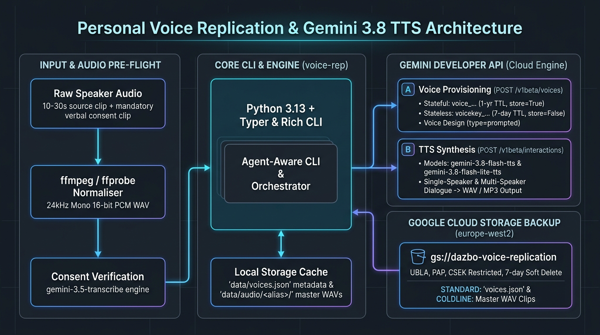

# Architecture and Walkthrough (`voice-replication`)

This document captures the architectural decisions, storage class economics, component interactions, and data models for the Personal Voice Replication & Expressive TTS Manager.

## Table of Contents

- [Architectural Decision Records (ADRs)](#architectural-decision-records-adrs)
- [Storage Architecture & GCS Cost Analysis](#storage-architecture--gcs-cost-analysis)
- [Component Architecture](#component-architecture)
- [Data Models](#data-models)
- [Key User Journeys](#key-user-journeys)

## Architectural Decision Records (ADRs)

| ID | Decision | Status | Context & Rationale |
| :--- | :--- | :--- | :--- |
| **ADR-01** | **Gemini API Stateful Storage (`store=True`) Scoped to `<your-project>`** | Accepted | Calling `client.voices.create(store=True, ...)` with a `GEMINI_API_KEY` provisioned inside `<your-project>` stores the verified `voice_...` profile on Google's servers for **1 year** (up to 200 voices per project), avoiding the need to re-upload biometric audio on every synthesis call while also supporting `--stateless` (`store=False`, 7-day `voicekey_...`) when zero server persistence is desired. |
| **ADR-02** | **Regional (`europe-west2`) GCS Bucket with `COLDLINE` Default + `STANDARD` Override for `voices.json`** | Accepted | Master 24kHz `.wav` recordings (~1.9 MB per voice) are written once and read at most once a year (when refreshing an expired 1-year `voice_...` TTL or bootstrapping a new workstation). `COLDLINE` (\$0.004/GiB/mo, 90-day min duration) provides millisecond access without thaw delays, while explicitly setting `blob.storage_class = "STANDARD"` on `voices.json` (~2 KB) prevents early-deletion charges whenever metadata is updated. |
| **ADR-03** | **Pre-Flight `ffmpeg` 24kHz Mono WAV Normalisation + `gemini-3.5-transcribe` Consent Check** | Accepted | Speaker verification in `POST /v1beta/voices` is sensitive to sample-rate mismatches, stereo channel phase, clip length outside 10–30s, and misread consent statements. Normalising to `pcm_s16le` 24kHz mono WAV via `ffmpeg` and verifying the consent recording with `gemini-3.5-transcribe` catches errors locally before hitting the Voices endpoint. |
| **ADR-04** | **Dual-Mode Agent-Aware CLI (`typer` + `rich`)** | Accepted | Following the `agent-aware-cli` pattern, every command provides Rich tables and semantic colours for human operators alongside `--json` deterministic output, `--dry-run` mutative safety, and `stderr` remediation hints for AI agents. |

## Storage Architecture & GCS Cost Analysis

Per the official [Google Cloud Storage Classes](https://docs.cloud.google.com/storage/docs/storage-classes) and [Cloud Storage Pricing](https://cloud.google.com/storage/pricing) documentation:

| Object | Typical Size | Access Frequency | Assigned Storage Class | Monthly Cost | Why |
| :--- | :--- | :--- | :--- | :--- | :--- |
| `audio/<alias>/source.wav` | ~1.4 MiB (30s @ 24kHz mono 16-bit) | Written once; read <= 1x/year on TTL refresh | `COLDLINE` (Bucket Default) | < \$0.00001 | 90-day minimum duration fits immutable master audio clips; millisecond retrieval on refresh. |
| `audio/<alias>/consent.wav` | ~0.5 MiB (10s @ 24kHz mono 16-bit) | Written once; read <= 1x/year on TTL refresh | `COLDLINE` (Bucket Default) | < \$0.00001 | Same lifecycle as `source.wav`. |
| `voices.json` | ~2 KiB | Updated on every `create`, `design`, `refresh`, or `delete` | `STANDARD` (Per-Object Override) | < \$0.00001 | Zero minimum storage duration and zero early-deletion fee on overwrites. |

### Bucket Security Baseline (`google-cloud-storage-bucket-architect`)

The backup bucket (`gs://<voice-name>-voice-replication` in `europe-west2`) enforces:

- **Uniform Bucket-Level Access (UBLA)**: Enabled (`--uniform-bucket-level-access`), disabling legacy object ACLs.
- **Public Access Prevention (PAP)**: Enforced (`--public-access-prevention`), blocking `allUsers` and `allAuthenticatedUsers`.
- **Encryption Enforcement**: Customer-Supplied Encryption Keys (CSEK) restricted (`FullyRestricted`), using Google-Managed Encryption Keys (GMEK).
- **Soft Delete**: Enabled with a 7-day retention window (`--soft-delete-duration=7d`) to protect against accidental deletion.

## Component Architecture

| Module | Responsibility | Key Dependencies |
| :--- | :--- | :--- |
| [src/voice_replication/config.py](../src/voice_replication/config.py) | Loads `.env` and environment variables into a typed `Settings` object | `pydantic-settings` |
| [src/voice_replication/models.py](../src/voice_replication/models.py) | Defines `VoiceRecord`, `VoiceCatalogue`, `AudioStats`, `ConsentCheckResult`, and `DialogueScript` | `pydantic`, `pyyaml` |
| [src/voice_replication/audio.py](../src/voice_replication/audio.py) | Wraps `ffprobe` inspection, `ffmpeg` 24kHz mono 16-bit PCM WAV normalisation, duration validation, and MP3 export | `subprocess`, `ffmpeg`, `ffprobe` |
| [src/voice_replication/consent.py](../src/voice_replication/consent.py) | Stores canonical consent phrases across locales and verifies consent WAVs via `gemini-3.5-transcribe` | `difflib`, `google-genai` |
| [src/voice_replication/client.py](../src/voice_replication/client.py) | Wraps `client.voices` (`create`, `list`, `get`, `delete`) and `client.interactions.create` (`gemini-3.8-flash-tts`) | `google-genai` |
| [src/voice_replication/storage.py](../src/voice_replication/storage.py) | Manages atomic local `data/voices.json` persistence, attributed `gcloud` preflight commands, and GCS push/pull | `google-cloud-storage` |
| [src/voice_replication/cli.py](../src/voice_replication/cli.py) | Exposes the `voice-rep` Typer CLI with Rich tables, `--json`, and `--dry-run` | `typer`, `rich` |

## Data Models

### `VoiceRecord` (Stored inside `data/voices.json`)

| Field | Type | Description |
| :--- | :--- | :--- |
| `alias` | `str` | Local friendly identifier (e.g. `dazbo`, `cohost`) |
| `display_name` | `str` | Human-readable name registered in Gemini Voices API |
| `voice_type` | `VoiceType` | `replicated` (from speaker audio) or `prompted` (Voice Design) |
| `storage_mode` | `StorageMode` | `stateful` (`store=True`, 365-day TTL) or `stateless` (`store=False`, 7-day TTL) |
| `voice_id` | `str \| None` | Server-side identifier (`voice_...`) returned when `store=True` |
| `voice_key` | `str \| None` | Encrypted client-side token (`voicekey_...`) returned when `store=False` |
| `model` | `str` | TTS model (`gemini-3.8-flash-tts` or `gemini-3.8-flash-lite-tts`) |
| `default_style` | `str \| None` | Default `speech_metadata` style instruction applied when `--style` is omitted |
| `created_at` | `datetime` | UTC creation timestamp |
| `expires_at` | `datetime` | Computed UTC expiration timestamp (`created_at + 365d` or `+ 7d`) |

## Key User Journeys

1. **Onboarding & Voice Creation**:
   - Run `uv run voice-rep prep-audio raw_ref.m4a raw_consent.m4a --alias dazbo`.
   - `audio.py` converts both clips to 24kHz mono 16-bit PCM WAV in `data/audio/dazbo/` and verifies `source.wav` is 10–30s.
   - `consent.py` transcribes `consent.wav` with `gemini-3.5-transcribe` and confirms `>=88%` word similarity with the mandatory consent statement.
   - Run `uv run voice-rep create --alias dazbo --display-name "Dazbo Primary"`.
   - `client.py` calls `client.voices.create(store=True, ...)` and saves the resulting `voice_...` ID to `data/voices.json`.
   - Run `uv run voice-rep sync --direction push` to archive `source.wav` and `consent.wav` in `COLDLINE` and `voices.json` in `STANDARD` inside `gs://<voice-name>-voice-replication`.
2. **Annual TTL Refresh (`refresh`)**:
   - When `uv run voice-rep list` shows a voice approaching its 365-day TTL, run `uv run voice-rep refresh dazbo`.
   - If local WAVs are missing (e.g. on a fresh machine), `uv run voice-rep sync --direction pull` restores them from GCS first, then `refresh` mints a fresh `voice_...` ID and updates `voices.json`.
